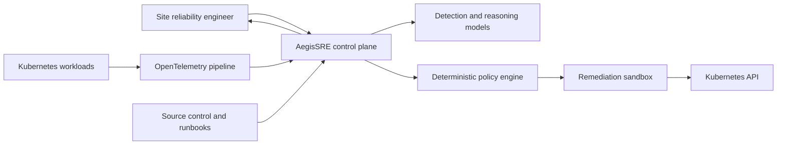

# System context

## Objective

AegisSRE reduces incident detection and recovery time without allowing generated text to
bypass operational controls. It separates probabilistic reasoning from deterministic
authorization and execution.

## System boundary

## Trust boundaries

Telemetry, documents, source content, prompts, model responses, and tool output are
untrusted. The policy engine accepts only validated typed operations. Credentials remain
outside model context and are scoped by workload identity and Kubernetes RBAC.

## Responsibility split

The control plane owns incident state, evidence provenance, orchestration, approval, and
audit records. Detection services own versioned model inference. Tool adapters own
external-system translation. The policy engine owns authorization. No model owns final
authorization.

## Initial runtime

The first milestone exposes the control-plane process, operational health contracts, and
metrics. Later milestones add integrations only through explicit interfaces and
architecture decision records.
